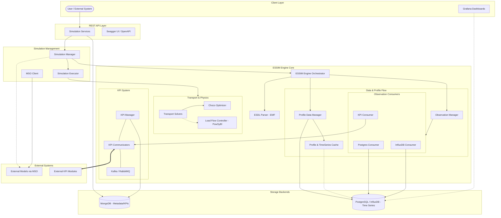

# ESSIM Architecture

## Introduction
ESSIM (Energy System Simulator) is a modular, JVM-based simulation engine designed for Energy System Scenario analysis. It leverages the Energy System Description Language (ESDL) to model complex multi-carrier energy systems and simulate their behavior over time.

## System Overview
ESSIM is built as a multi-module Maven project, primarily consisting of the `commons` and `essim-engine` modules. It exposes a REST API for simulation management and integrates with various backends for metadata and time-series data storage.

### Key Features
- **ESDL-based Modeling**: Uses ESDL for describing energy assets, carriers, and their connections.
- **Multi-Carrier Simulation**: Supports electricity, gas, heat, and other energy carriers.
- **Transport Solving**: Balances supply and demand across networks while respecting transport constraints.
- **Power Grid Analysis**: Integrates with PowSyBl for detailed AC load-flow calculations.
- **KPI Engine**: Computes various Key Performance Indicators (KPIs) like energy balance, curtailment, and CO2 emissions.
- **Flexible Backends**: Supports MongoDB for metadata and PostgreSQL/InfluxDB for time-series results.

## High-Level Architecture

## Core Modules

### 1. Commons (`/commons`)
Contains shared utilities and data structures used across the project:
- **Time/Horizon Utilities**: `EssimTime`, `EssimDuration` for handling simulation time steps.
- **Bid Functions**: `BidFunction` for modeling market-based interactions.
- **Credential Management**: `CredentialUtils` for secure access to backends via `~/.essim-credentials`.
- **Common Interfaces**: `Simulatable`, `IStatusProvider`, and `ISimulationManager`.

### 2. ESSIM Engine (`/essim-engine`)
The core simulation engine and REST server:
- **REST Layer (`nl.tno.essim.rest`)**: Jetty/Jersey based implementation. Provides endpoints for simulation control, status monitoring, and data retrieval.
- **Simulation Management (`nl.tno.essim.managers`)**:
    - `SimulationManager`: Orchestrates the simulation lifecycle and time-stepping.
    - `SimulationExecutor`: A thread pool manager that enables parallel execution of multiple transport solvers.
- **Core Engine (`nl.tno.essim.ESSimEngine`)**: The main orchestrator that sets up the environment, parses the ESDL model using EMF, and initializes solvers and managers.
- **Transport Solver (`nl.tno.essim.transportsolver`)**: Balances energy supply and demand.
    - Uses **Choco Optimizer** for constraint programming.
    - Models various energy assets as nodes (e.g., `ProducerNode`, `ConsumerNode`, `StorageNode`, `ConversionNode`).
    - See [Market Prices and Profiles](market-prices.md) for details on how balancing prices and carrier costs are handled.
- **Load Flow (`nl.tno.essim.loadflow`)**: Integrates **PowSyBl** for electrical AC load-flow calculations. It translates the transport solution into a physical network model to compute voltages and currents.
- **Observation Management (`nl.tno.essim.observation`)**:
    - `ObservationManager`: Dispatches simulation results to registered consumers.
    - **Consumers**: Pluggable modules like `PostgresObservationConsumer`, `InfluxDBObservationConsumer`, and `KPIObservationConsumer`.
- **Profile Management (`nl.tno.essim.profiles`)**:
    - `ProfileDataManager`: Handles loading, resampling, and caching of time-series input data from various sources (InfluxDB, PostgreSQL, or embedded in ESDL).
- **KPI Management (`nl.tno.essim.kpi`)**:
    - `KPIManager`: Manages a modular KPI system that can communicate with external modules via message brokers.

## Node Classes & Transport Solving

ESSIM models energy assets as a hierarchy of nodes within a transport network. Each network is managed by a `TransportSolver`, which orchestrates the communication between nodes to achieve energy balance.

### Node Hierarchy & Life-cycle

Nodes are organized in a tree structure that reflects the topology of the energy network.
- **Root Node**: Represents the network's main balance point.
- **Transport Nodes**: Represent cables, pipes, or other transport assets.
- **Device Nodes**: Leaf nodes (or sub-trees) representing actual energy assets (producers, consumers, storage, converters).

Within each simulation time step, nodes follow a strictly defined life-cycle:

1.  **`createBidCurve`**: Each device node calculates its supply or demand potential. It generates a `BidFunction` (a curve of energy vs. price) based on its current state, input profiles, and operational constraints.
2.  **Aggregation**: Starting from the leaves, each node aggregates the bid curves of its children. The root node eventually holds the combined bid function for the entire network.
3.  **Market Clearing**: The `TransportSolver` finds the "Market Clearing Price" where total supply equals total demand (or minimizes imbalance).
4.  **`calculateAssignedEnergies`**: The clearing price is propagated back down the tree. Each node determines its assigned energy based on its individual bid function and the clearing price.
5.  **`processAllocation`**: Once the energy flow is determined, nodes finalize their internal state, calculate secondary effects (like fuel consumption or emissions), and record observations.

### Core Implementation

- **`INode` Interface**: The contract for all nodes, defining `createBidCurve` and `processAllocation`.
- **`Node` Base Class**: Provides the fundamental implementation for tree management, bid curve aggregation, and energy assignment. It handles common asset properties like commissioning dates and basic bid types (inflexible/adjustable).
- **`AbstractBasicConversionNode`**: A specialized base class for assets that convert energy between carriers (e.g., Heat Pumps, Gas Heaters, Electrolyzers).
    - **Efficiency & Ratios**: Uses a `ratioMap` to define the energy relationship between its ports. For example, a boiler might have a ratio of 1.0 on its heat output port and 1.11 (1/0.9 efficiency) on its gas input port.
    - **Control Strategies**: Supports different strategies like `DrivenByDemand`, `DrivenBySupply`, or `DrivenByProfile`.

### Key Node Types

| Node Type | Description |
| :--- | :--- |
| **`ProducerNode`** | Generates energy based on profiles (e.g., Wind/Solar) or available capacity and marginal costs. |
| **`ConsumerNode`** | Demands energy based on profiles (e.g., Households) or flexible demand models. |
| **`StorageNode`** | Models batteries, heat buffers, or reservoirs. Manages State of Charge (SoC) and provides flexibility to the network. |
| **`ConversionNode`** | Linked across multiple networks, allowing energy to flow from one carrier to another (e.g., a Power-to-Heat asset). |
| **`TransportNode`** | Models constraints like maximum capacity and losses in the distribution network. |

## Profile Handling

ESSIM relies heavily on time-series data, referred to as **Profiles**, to drive the simulation. Profiles are used for energy demand, weather data (solar/wind), market prices, and other time-varying parameters.

### Supported Profile Types

ESSIM supports several ESDL profile types, each handled by a specialized `ProfileDataHandler`:

*   **`TimeSeriesProfile`**: Values are embedded directly within the ESDL model as a list of numbers with a fixed time step.
*   **`InfluxDBProfile`**: Data is retrieved from an external InfluxDB (1.x) instance.
*   **`DataTableProfile`**: Data is retrieved from a relational database (typically PostgreSQL/TimescaleDB) using a `DatabaseConfiguration`.
*   **`SingleValue`**: A constant value used throughout the entire simulation.
*   **`DateTimeProfile`**: A profile where each element has an explicit start and end time.

### Profile Data Management

The `ProfileDataManager` is the central component for profile interactions:
- **Initialization**: At simulation start, it scans the ESDL model and initializes appropriate data handlers for all found profiles.
- **Reading**: Nodes call `readProfile(profile, horizon)` to get the value for the current simulation time step.
- **Resampling**: ESSIM automatically handles resampling if the profile's time step differs from the simulation's time step.
    - **Upsampling**: If the simulation step is smaller than the profile step, values are interpolated or held.
    - **Downsampling**: If the simulation step is larger, values are aggregated (summed or averaged).

### Energy vs. Power Profiles

ESSIM distinguishes between different physical quantities to ensure correct aggregation during resampling:
- **Energy Profiles**: (e.g., Joule, kWh) Values represent a quantity over an interval. When resampling, ESSIM **sums** the partial values.
- **Power/State Profiles**: (e.g., Watt, Temperature, Price) Values represent an instantaneous state. When resampling, ESSIM calculates a **weighted average** over the interval.

### Percentage Profiles (Scaling)

Profiles with the physical quantity `COEFFICIENT` (percentage) are automatically scaled by the `ProfileDataManager`. If a percentage profile is assigned to an asset, ESSIM multiplies the profile value by the asset's rated power (e.g., `Producer.getPower()`). This allows a single normalized solar profile to be reused across many solar parks with different capacities.

### Caching Strategy

To ensure high performance, especially when using external databases, ESSIM employs a multi-level caching strategy:
- **`ProfileCache`**: A singleton that caches `TimeSeriesDataCache` objects globally across the simulation.
- **`TimeSeriesDataCache`**: Stores the raw time-series data for a specific profile, reducing the number of database queries.

## Parallel Execution & Scalability
ESSIM is designed to handle large-scale energy systems by:
1.  **Parallel Solver Execution**: The `SimulationManager` uses a thread pool (`SimulationExecutor`) to run independent `TransportSolver` instances (e.g., for different carriers or disconnected regions) in parallel.
2.  **Asynchronous Observations**: Observation consumers (especially for databases) often use internal buffering and asynchronous writes to minimize the impact on simulation performance.
3.  **Caching**: Input profiles are cached in memory to reduce database load during the simulation execution loop.

## Modular KPI System

ESSIM features a highly decoupled and extensible KPI (Key Performance Indicator) system. Instead of calculating all metrics internally, it delegates KPI computation to external modules, which can be independent microservices written in any language.

### System Architecture

The KPI system follows a producer-consumer pattern over a message broker:

1.  **KPI Discovery**: External KPI modules announce their presence by sending status messages. The `KPIManager` maintains a registry of these modules, including their supported KPI types and configurations.
2.  **Simulation Start**: When a simulation starts, ESSIM identifies the required KPIs and sends a `KPIStart` message to the corresponding external modules via the `KPICommunicator`. This message includes the simulation ID, module configuration, and the expected number of messages.
3.  **Data Streaming**: During the simulation loop, the `ObservationManager` dispatches results to the `KPIObservationConsumer`. This consumer wraps each observation into a `KPIData` object (containing fields, tags, and timestamps) and streams it to the message broker.
4.  **External Computation**: The external modules consume the observation stream, perform their specific calculations (e.g., total CO2, energy balance, cost analysis), and produce a `KPIResult`.
5.  **Result Persistence**: The `KPIManager` receives the `KPIResult` and stores it in **MongoDB**, making it available via the REST API for frontend visualization.

### Supported Message Brokers

To ensure flexibility in different deployment environments, ESSIM supports multiple message brokers through specialized `KPICommunicator` implementations:
- **Kafka**: Used for high-throughput, distributed streaming.
- **RabbitMQ**: A widely used, robust message broker.

The broker type and connection details are configured via environment variables (`KAFKA_URL`, `RABBITMQ_URL`).

### Data Structures

The communication protocol uses several key data structures (defined in the `commons` module):
- **`KPIData`**: The envelope for simulation observations. It includes:
    - `measurement`: The source of the observation (e.g., asset name).
    - `time`: Unix timestamp of the observation.
    - `fields`: A map of numeric values (e.g., `power`, `energy`).
    - `tags`: Metadata for filtering (e.g., `carrierId`, `nodeType`).
- **`KPIControlMessage`**: Handles the lifecycle (Start, Stop, Status, Finished).
- **`KPIResult`**: The output from the external module, typically containing a JSON blob representing the calculated metrics.

## Simulation Lifecycle

1.  **Creation**: A simulation is created via `POST /essim/simulation` with an ESDL model and configuration. Metadata is stored in MongoDB.
2.  **Initialization**:
    - The ESDL model is parsed.
    - Transport networks are identified for each carrier.
    - `TransportSolver` instances are created for each network.
    - If enabled, the `EssimLoadFlowController` is initialized.
    - Profiles (input data) are loaded and cached.
3.  **Execution Loop**:
    - For each time step:
        - Input profiles are sampled.
        - **Transport Solving**: Each `TransportSolver` balances its network.
        - **Load Flow**: If it's an electricity network, PowSyBl performs AC load-flow based on the transport solution.
        - **Observations**: Results (power flows, voltages, etc.) are collected.
        - **KPIs**: Incremental KPIs are updated.
4.  **Finalization**:
    - Results are flushed to the time-series backends (PostgreSQL/InfluxDB).
    - Final KPIs are computed.
    - Simulation status is updated in MongoDB.

## Data Storage Strategy

### Metadata (MongoDB)
MongoDB is used to store:
- Simulation configurations and status.
- ESDL model snippets.
- KPI results and simulation logs.

### Time-Series Data (PostgreSQL / InfluxDB)
- **Input Profiles**: Read from PostgreSQL or InfluxDB.
- **Simulation Results**: Observations are written to these backends.
- **PostgreSQL (Recommended)**: Preferred for its maturity and TimescaleDB extension for performance.
- **InfluxDB (Legacy)**: Supported for older installations (InfluxDB 1.x).

See [Database Backends](database-backends.md) for more details.

## Technology Stack
- **Language**: Java 21
- **Build System**: Maven
- **Frameworks**:
    - **Jetty & Jersey**: HTTP server and REST API.
    - **EMF (Eclipse Modeling Framework)**: For handling ESDL (XMI).
    - **PowSyBl**: Power system modeling and load-flow (see [PowSyBl Integration](powsybl-integration.md)).
    - **Choco Solver**: Constraint programming for transport optimization.
    - **Lombok**: Reducing boilerplate code.
- **Databases**: MongoDB, PostgreSQL, InfluxDB.

## External Integrations
- **ESDL**: The primary language for describing the energy system.
- **Grafana**: ESSIM can generate Grafana dashboard configurations for visualizing results.
- **External Models**: Support for interacting with external models via an MSO client or external KPI modules. See [Working with External Models](external-models.md).
- **MSO (Model Service Orchestration)**: Support for interacting with external models via an MSO client.
